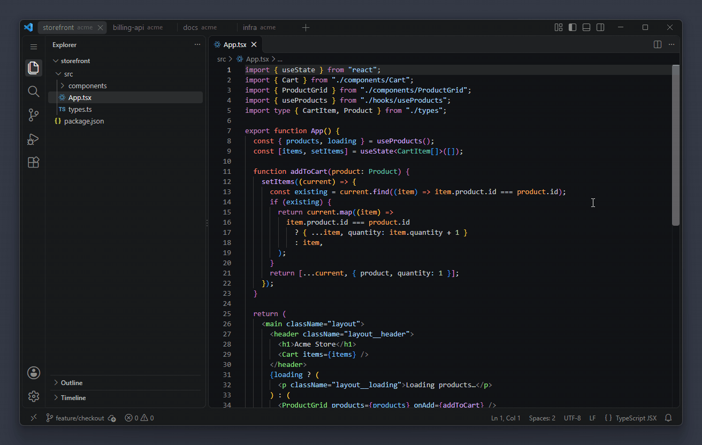
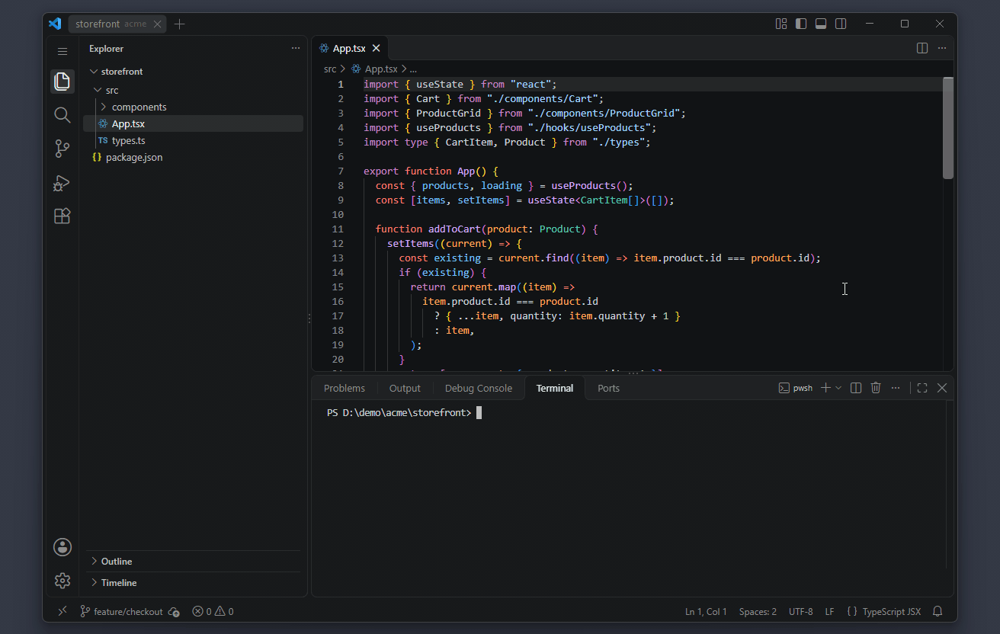
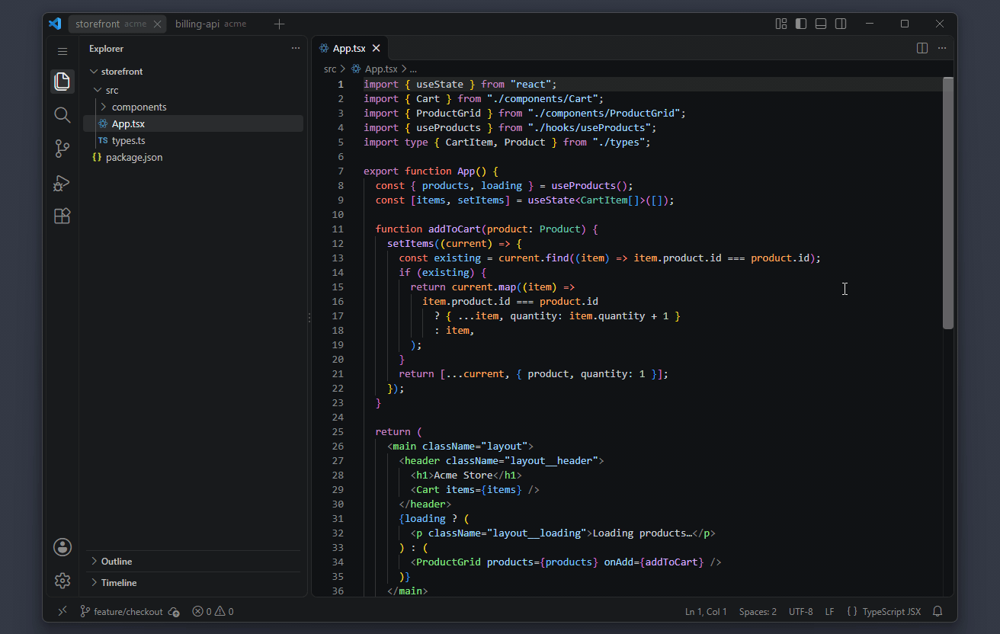
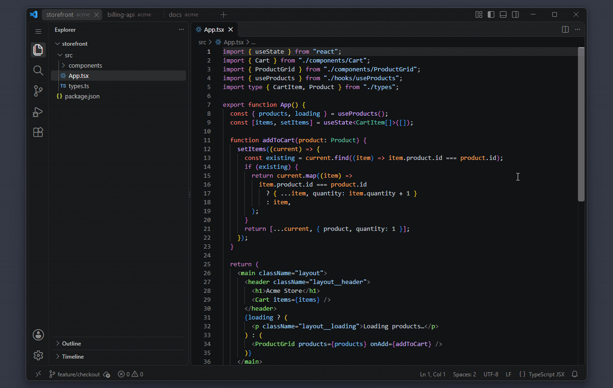
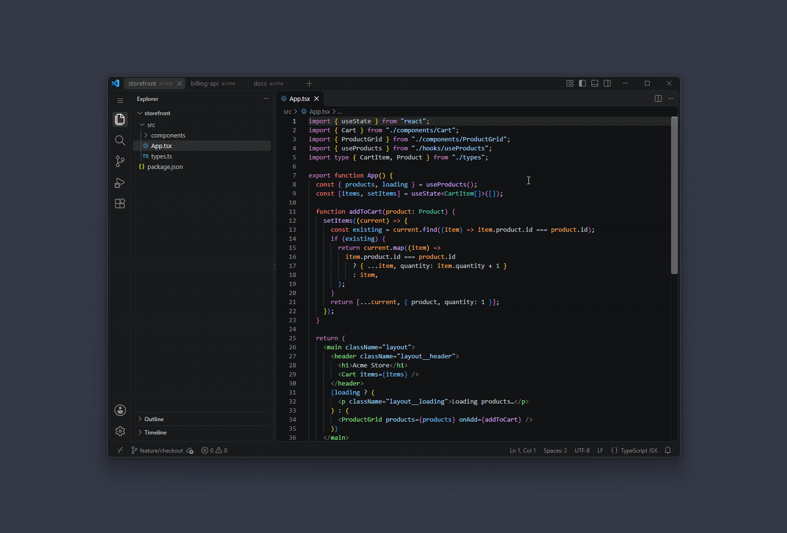
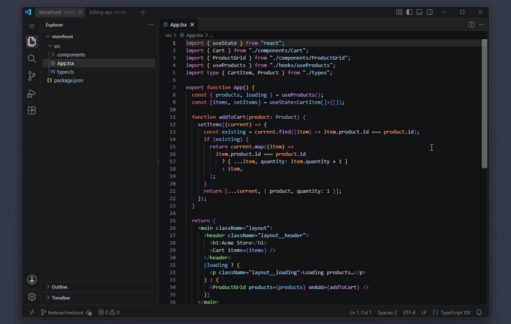

<h1 align="center">VS Code Tabs</h1>

  Group VS Code windows into tabs in the title bar on Windows.

  
  

VS Code Tabs groups open VS Code windows into tabs in the title bar, keeping one window visible per group while parking the rest off-screen and off the taskbar.
The extension prepares the title bar and starts a bundled helper (`vscode-tabs.exe`) that tracks the windows and draws the tab strip.
It runs on Windows x64 only.

## Usage

1. **Apply the title bar settings.**
   On first start, the extension prompts to update four VS Code settings so the title bar has room for tabs and `Ctrl+Tab` works from the integrated terminal.
   Choose "Apply" to write those user settings.
2. **Open a second VS Code window.**
   The bundled helper starts automatically with VS Code and places both windows as tabs in the title bar.
   New VS Code windows join the focused group as tabs.
   Windows of a different VS Code installation, such as a portable copy, form their own groups.

   
3. **Switch windows or open a new one.**
   Click a tab or press `Ctrl+Tab` and `Ctrl+Shift+Tab` to move between windows in the group.
   Click `+` in the tab bar to open a new VS Code window in the current group.

   
4. **Close a tab or the whole group.**
   Click a tab's close button or middle-click the tab to close that one window.
   Closing the window itself with its X, `Alt+F4` or `Ctrl+Shift+W` closes every tab in its group, like closing a browser window.
5. **Reorder or detach tabs.**
   Drag a tab sideways in the bar to reorder it, or drag it out to the desktop to detach it into its own window.
   You can also drop a dragged tab onto another VS Code window's tab bar to move it into that group.

   

   
6. **Stop the helper from the system tray.**
   While the helper is running, a VS Code Tabs icon sits in the Windows system tray.
   Right-click the icon and select "Exit" to stop the helper and restore all grouped windows to the desktop and taskbar.

## Colour themes

The tab bar takes its colours from the window's own title bar, so it follows any colour theme without extra settings, including the live preview while you pick a theme.

## License

GPL-3.0-or-later. See [LICENSE](LICENSE).
